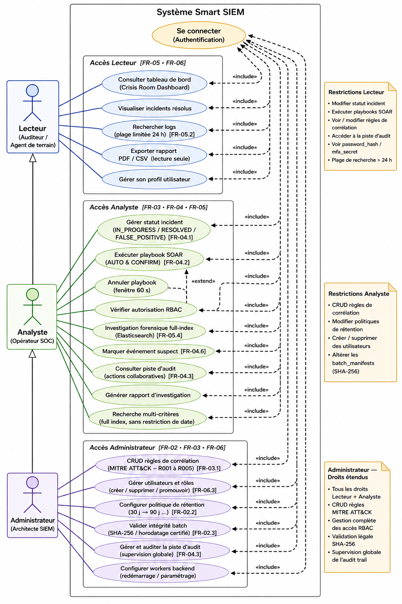
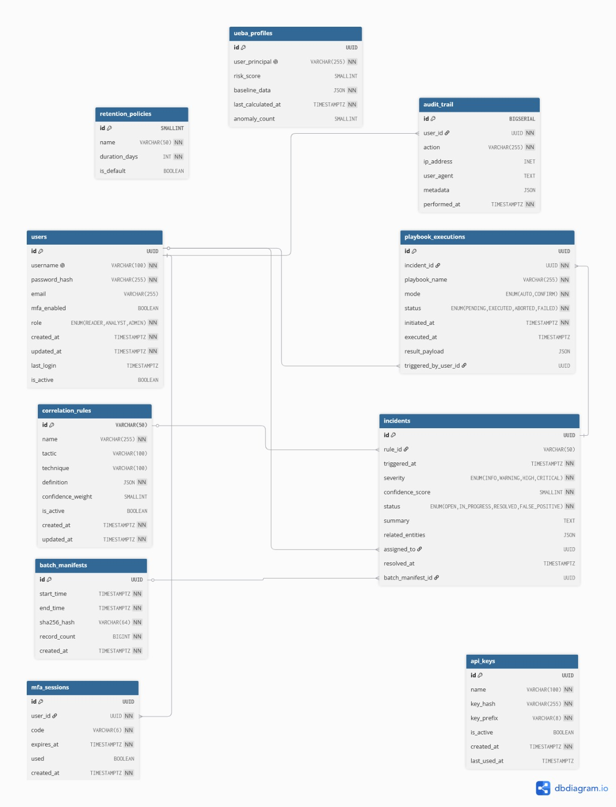
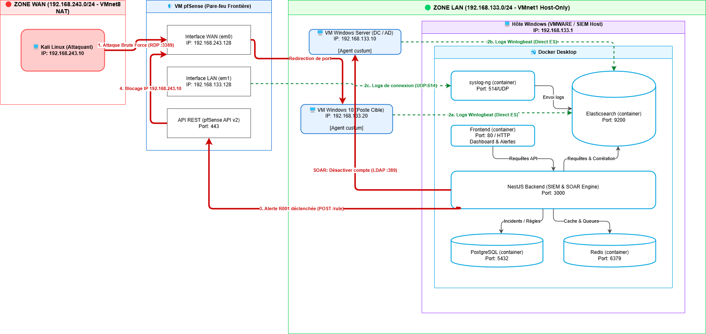

# Diagrammes du Système
Ce document regroupe les schémas d'architecture et de modélisation du système.

## 1. Diagramme de Cas d’Utilisation

## 2. Diagramme de Classes
[smart_siem_-_class.pdf](/smart_siem_-_class.pdf)

## 3. Diagramme Entité-Relation (ERD)

## 4. Architecture Globale du Système
